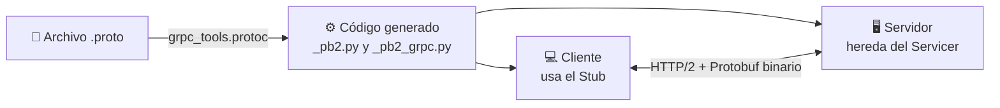
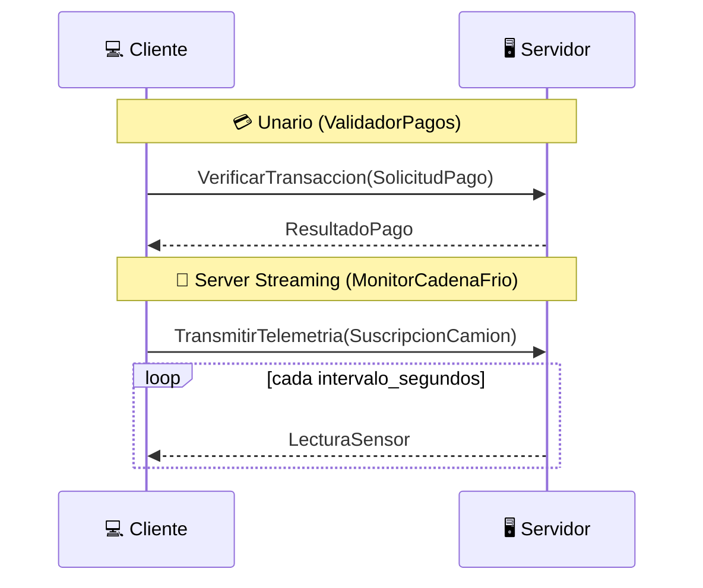

<div align="center">

# 🌐 Microservicios Distribuidos en Tiempo Real con gRPC

### Dos casos empresariales que recorren los patrones de gRPC: una validación de pagos **unaria** y un monitor IoT con **Server Streaming**


</div>

---

## 📖 Descripción

Repositorio con dos microservicios construidos con **gRPC** y **Protocol Buffers** en Python. Cada carpeta es un proyecto independiente que resuelve un problema real de la industria y practica un patrón de comunicación distinto.

> 💡 **Idea central:** el contrato se escribe una sola vez en un archivo `.proto`. A partir de él, `protoc` genera el código del cliente (*stub*) y la base del servidor (*servicer*), y los mensajes viajan en binario sobre HTTP/2.

---

## 🗺️ Mapa de proyectos

| | Proyecto | Patrón gRPC | Servicio | Puerto |
|---|---|---|---|---|
| 💳 | [`payment-fraud-validator`](payment-fraud-validator) | **Unario:** una petición, una respuesta | `ValidadorPagos` | `50051` |
| 🚚 | [`iot-coldchain-stream-monitor`](iot-coldchain-stream-monitor) | **Server Streaming:** una petición, un flujo continuo de respuestas | `MonitorCadenaFrio` | `50052` |

> 📂 Cada carpeta incluye su propio `README.md` con el contrato, las reglas de negocio, los comandos y la salida esperada.

---

## 💳 Proyecto 1: Validador de Pagos

Una pasarela de pagos debe decidir **en menos de 50 ms** si autoriza una compra con tarjeta. El cliente envía la transacción y el servidor responde al instante si fue **aprobada** o **rechazada**.

| Regla | Resultado |
|---|---|
| Monto `<= 0` o tarjeta sin 16 dígitos | ❌ `INVALID_ARGUMENT` |
| Tarjeta que inicia con `4000` (lista negra) | 🚫 `PERMISSION_DENIED` |
| Monto `> $10,000` desde un país distinto a `US` o `MX` | ⚠️ `aprobado = false` por política de fraude |
| Ninguna de las anteriores | ✅ Aprobado con código `AUT-XXXXXXXX` |

➡️ [Ver documentación completa](payment-fraud-validator/README.md)

---

## 🚚 Proyecto 2: Monitor de Cadena de Frío

Una empresa farmacéutica transporta vacunas que deben mantenerse **entre 2 °C y 8 °C**. La central se suscribe a un camión y recibe sus lecturas de temperatura y ubicación **en tiempo real**, sin volver a preguntar.

| Regla | Resultado |
|---|---|
| Camión no registrado | ❌ `NOT_FOUND` |
| Camión válido | 📡 Lecturas continuas emitidas con `yield` cada `intervalo_segundos` |
| Temperatura `< 2.0 °C` o `> 8.0 °C` | 🔴 `alerta_critica = true`, resaltada en rojo en el cliente |

➡️ [Ver documentación completa](iot-coldchain-stream-monitor/README.md)

---

## 🏗️ Arquitectura general

Los dos proyectos comparten el mismo flujo de trabajo: **contrato → código generado → servidor y cliente**.



### 🔀 Patrones de comunicación



| Patrón | Petición | Respuesta | En el servidor | En el cliente |
|---|---|---|---|---|
| **Unario** | Un mensaje | Un mensaje | `return ResultadoPago(...)` | `resultado = stub.Metodo(peticion)` |
| **Server Streaming** | Un mensaje | Flujo de mensajes | `yield LecturaSensor(...)` | `for respuesta in stub.Metodo(peticion):` |

---

## 📁 Estructura del repositorio

```text
distributed-realtime-microservices/
├── 💳 payment-fraud-validator/          # Unario
│   ├── protos/validador_pagos.proto
│   ├── servidor.py
│   ├── cliente.py
│   └── requirements.txt
├── 🚚 iot-coldchain-stream-monitor/     # Server Streaming
│   ├── protos/monitor_cadena_frio.proto
│   ├── servidor.py
│   ├── cliente.py
│   └── requirements.txt
└── 🙈 .gitignore
```

> ℹ️ Los archivos `*_pb2.py` y `*_pb2_grpc.py` de cada carpeta los genera `protoc` y se incluyen en el repositorio para poder ejecutar los proyectos sin regenerarlos.

---

## 🛠️ Preparación

> 🐍 Requiere **Python 3.10 o superior**.

Desde la raíz del repositorio, crea y activa un entorno virtual:

```powershell
python -m venv .venv
.\.venv\Scripts\Activate.ps1
```

En Linux o macOS, la activación es `source .venv/bin/activate`.

Instala las dependencias (son las mismas en los dos proyectos):

```powershell
pip install -r payment-fraud-validator/requirements.txt
```

| Dependencia | Para qué sirve |
|---|---|
| `grpcio` | Servidor, cliente y canal gRPC |
| `grpcio-tools` | Compilador `protoc` para generar código desde el `.proto` (instala `protobuf`) |

---

## 🚀 Ejecución rápida

Cada proyecto usa **dos terminales** abiertas en la raíz, con `.venv` activado. Primero el servidor y después el cliente.

| Proyecto | 1️⃣ Servidor | 2️⃣ Cliente |
|---|---|---|
| 💳 Pagos | `python payment-fraud-validator\servidor.py` | `python payment-fraud-validator\cliente.py` |
| 🚚 Cadena de frío | `python iot-coldchain-stream-monitor\servidor.py` | `python iot-coldchain-stream-monitor\cliente.py` |

> 🔁 Como usan puertos distintos, los dos servidores pueden estar encendidos al mismo tiempo.
> ⛔ El monitor de cadena de frío transmite sin parar: detén el cliente con `Ctrl + C`.

---

## 🧠 Conceptos clave

| Concepto | Qué demuestra | Proyecto |
|---|---|---|
| Contrato `.proto` | Servicio y mensajes definidos una vez, independientes del lenguaje | Ambos |
| `grpc_tools.protoc` | Generación automática del stub y del servicer | Ambos |
| RPC unario | Respuesta síncrona de baja latencia | 💳 Pagos |
| `returns (stream ...)` y `yield` | El servidor envía mensajes conforme se producen | 🚚 Cadena de frío |
| `for respuesta in stub...` | El cliente procesa cada evento en cuanto llega | 🚚 Cadena de frío |
| `context.set_code` y `set_details` | Errores con códigos de estado estándar de gRPC | Ambos |
| `context.is_active()` | El stream se detiene cuando el cliente se desconecta | 🚚 Cadena de frío |
| `except grpc.RpcError as e` | El cliente lee `e.code()` y `e.details()` | Ambos |

### 🚦 Códigos de estado gRPC usados

| Código | Cuándo aparece | Proyecto |
|---|---|---|
| `OK` | La llamada terminó sin errores | Ambos |
| `INVALID_ARGUMENT` | Monto o número de tarjeta inválido | 💳 Pagos |
| `PERMISSION_DENIED` | Tarjeta en lista negra | 💳 Pagos |
| `NOT_FOUND` | Camión no registrado | 🚚 Cadena de frío |
| `UNAVAILABLE` | El servidor no está encendido | Ambos |

---

## 🔒 Consideraciones

- 🔓 Los canales usan `insecure_channel` (sin TLS). Están pensados para ejecución local; en producción se usaría `secure_channel` con certificados.
- 🧪 Los datos son **simulados**: las tarjetas son de prueba y la telemetría se genera con `random`.
- 🧠 No hay base de datos: las reglas y los registros viven como constantes en cada `servidor.py`.

---

## 🛠️ Tecnologías

- 🐍 [Python](https://www.python.org/)
- 🔗 [gRPC para Python](https://grpc.io/docs/languages/python/)
- 📦 [Protocol Buffers](https://protobuf.dev/)

---

<div align="center">

⭐ Si este repositorio te fue útil, ¡no olvides dejar una estrella! ⭐

</div>
