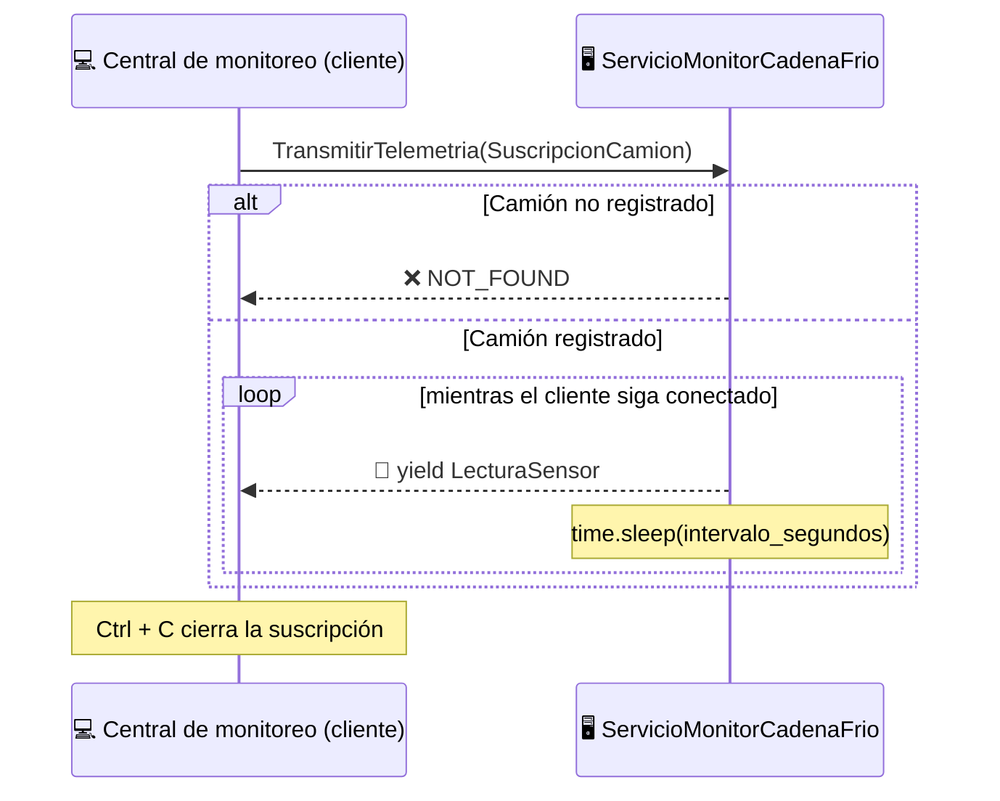
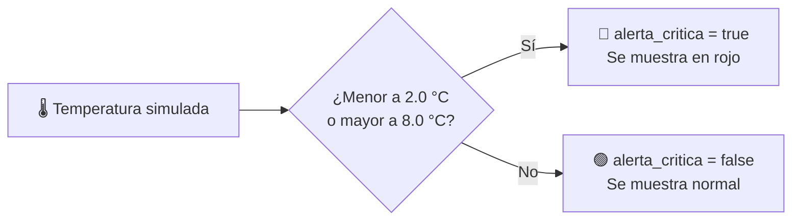

<div align="center">

# 🚚 Monitor de Cadena de Frío IoT (gRPC Server Streaming)

### La central de monitoreo se suscribe a un camión y recibe su telemetría **en tiempo real**, con alertas cuando las vacunas salen de **2 °C a 8 °C**


</div>

---

## 📖 Descripción

Una empresa de logística farmacéutica transporta vacunas que necesitan una **cadena de frío estricta entre 2 °C y 8 °C**. Cada camión transmite su telemetría y la central de monitoreo necesita reaccionar **de inmediato** si la temperatura sale del rango.

Este proyecto implementa el patrón **Server Streaming**: el cliente envía **una sola petición** de suscripción y el servidor responde con un **flujo continuo** de lecturas, emitidas una a una con `yield`.

> 💡 **Idea central:** el cliente no pregunta una y otra vez por la temperatura. Se suscribe una vez y el servidor le **empuja** cada lectura en cuanto se genera.

---

## ✨ Características

| | Característica |
|---|---|
| 📡 | **Server Streaming:** una petición y un flujo de respuestas que no se corta |
| 🌡️ | **Lecturas simuladas** de temperatura, latitud, longitud y hora |
| ⏱️ | **Intervalo configurable:** el cliente elige cada cuántos segundos recibe una lectura |
| 🔴 | **Alertas críticas** resaltadas en rojo cuando la temperatura sale del rango |
| 🔍 | **Validación del camión:** si no está registrado responde `NOT_FOUND` |
| 🔌 | **Cierre limpio:** el servidor deja de emitir cuando el cliente se desconecta (`context.is_active()`) |
| 🧯 | **Cliente robusto:** captura `grpc.RpcError` y se detiene con `Ctrl + C` |

---

## 🏗️ Arquitectura



### 🌡️ Evaluación de cada lectura



---

## 📜 Contrato del servicio

Archivo [`protos/monitor_cadena_frio.proto`](protos/monitor_cadena_frio.proto):

```proto
service MonitorCadenaFrio {
  rpc TransmitirTelemetria (SuscripcionCamion) returns (stream LecturaSensor);
}

message SuscripcionCamion {
  string id_camion = 1;
  int32 intervalo_segundos = 2;
}

message LecturaSensor {
  string id_camion = 1;
  double temperatura_celsius = 2;
  double latitud = 3;
  double longitud = 4;
  string timestamp = 5;
  bool alerta_critica = 6;
}
```

> 🔑 La palabra **`stream`** en la respuesta es lo que convierte al RPC en **Server Streaming**.

| Mensaje | Campo | Descripción |
|---|---|---|
| `SuscripcionCamion` | `id_camion` | Camión al que se suscribe la central |
| | `intervalo_segundos` | Tiempo entre una lectura y la siguiente |
| `LecturaSensor` | `id_camion` | Camión que generó la lectura |
| | `temperatura_celsius` | Temperatura de la carga |
| | `latitud` / `longitud` | Ubicación del camión |
| | `timestamp` | Fecha y hora de la lectura |
| | `alerta_critica` | `true` si la temperatura está fuera de 2 °C a 8 °C |

---

## 🧯 Reglas de negocio y manejo de errores

| # | Situación | Respuesta del servidor |
|---|---|---|
| 1 | `id_camion` no está registrado (`CAM-001`, `CAM-002` o `CAM-003`) | `context.set_code(grpc.StatusCode.NOT_FOUND)` con *"Camión <id> no encontrado"* |
| 2 | Camión registrado | Bucle con `time.sleep(intervalo_segundos)` que emite cada lectura con `yield LecturaSensor(...)` |
| 3 | Temperatura `< 2.0 °C` o `> 8.0 °C` | La lectura se envía con `alerta_critica = true` |
| 4 | El cliente se desconecta | `context.is_active()` pasa a `false` y el servidor deja de emitir |

---

## 🧩 Clases principales

| Clase | Archivo | Responsabilidad |
|---|---|---|
| `ServicioMonitorCadenaFrio` | `servidor.py` | Valida el camión y emite las lecturas con `yield` |
| `ClienteMonitorCadenaFrio` | `cliente.py` | Se suscribe, recorre el stream con `for respuesta in ...` y resalta las alertas |

Métodos internos:

| Método | Clase | Qué hace |
|---|---|---|
| `_generar_lectura(id_camion)` | Servidor | Crea una `LecturaSensor` con temperatura y ubicación aleatorias |
| `_es_alerta_critica(temperatura)` | Servidor | Indica si la temperatura está fuera del rango permitido |
| `_mostrar_lectura(lectura)` | Cliente | Imprime la lectura, en rojo si tiene alerta crítica |

---

## 📁 Estructura del proyecto

```
📦 iot-coldchain-stream-monitor
 ┣ 📂 protos
 ┃ ┗ 📜 monitor_cadena_frio.proto      # Contrato del servicio
 ┣ 📜 monitor_cadena_frio_pb2.py       # Generado: clases de los mensajes
 ┣ 📜 monitor_cadena_frio_pb2_grpc.py  # Generado: stub y servicer
 ┣ 📜 servidor.py                      # Servidor que emite la telemetría con yield
 ┣ 📜 cliente.py                       # Cliente que consume el stream y resalta alertas
 ┣ 📜 requirements.txt                 # Dependencias
 ┗ 📜 README.md                        # Documentación
```

---

## ⚙️ Requisitos

- **Python 3.10 o superior**
- **grpcio**
- **grpcio-tools**

```bash
pip install -r requirements.txt
```

Para regenerar el código después de modificar el `.proto`:

```bash
python -m grpc_tools.protoc -I protos --python_out=. --grpc_python_out=. protos/monitor_cadena_frio.proto
```

---

## 🚀 Ejecución paso a paso

Abre **dos terminales** en la carpeta del proyecto, con el entorno virtual activado.

### 1️⃣ Iniciar el servidor

```bash
python servidor.py
```

```
Servidor MonitorCadenaFrio escuchando en [::]:50052
```

### 2️⃣ Suscribirse con el cliente

```bash
python cliente.py
```

Las lecturas empiezan a llegar una por una. El stream es **continuo**: termina cuando presionas `Ctrl + C`.

> 🔁 Para vigilar varios camiones a la vez, abre más terminales con el cliente y cambia `ID_CAMION` en cada una.

---

## 🧪 Resultado esperado

### ✅ Camión registrado (`CAM-001`)

Las lecturas con alerta crítica aparecen en **rojo** en la consola:

```
Suscrito a la telemetría de CAM-001 (Ctrl+C para detener)

[2026-11-16T17:21:49] CAM-001 |  2.44 °C | (19.4284, -99.1331)
[2026-11-16T17:21:50] CAM-001 |  2.75 °C | (19.4392, -99.1251)
[2026-11-16T17:21:51] CAM-001 |  1.50 °C | (19.4231, -99.1369) | ¡ALERTA CRÍTICA: temperatura fuera de rango!
[2026-11-16T17:21:52] CAM-001 |  9.68 °C | (19.4284, -99.1356) | ¡ALERTA CRÍTICA: temperatura fuera de rango!

Monitoreo detenido
```

### ❌ Camión no registrado (`CAM-999`)

```
Suscrito a la telemetría de CAM-999 (Ctrl+C para detener)

Código de error: StatusCode.NOT_FOUND
Detalle: Camión CAM-999 no encontrado
```

> 🎲 Las temperaturas y coordenadas son aleatorias, así que cambian en cada ejecución.

---

## 🎛️ Configuración

Todo lo editable está como constante al inicio de cada archivo:

| Archivo | Constante | Valor | Para qué sirve |
|---|---|---|---|
| `servidor.py` | `DIRECCION` | `[::]:50052` | Dirección y puerto del servidor |
| `servidor.py` | `TEMPERATURA_MINIMA` | `2.0` | Límite inferior de la cadena de frío |
| `servidor.py` | `TEMPERATURA_MAXIMA` | `8.0` | Límite superior de la cadena de frío |
| `servidor.py` | `CAMIONES` | `CAM-001`, `CAM-002`, `CAM-003` | Camiones registrados y su ubicación inicial |
| `cliente.py` | `DIRECCION_SERVIDOR` | `localhost:50052` | Servidor al que se conecta el cliente |
| `cliente.py` | `ID_CAMION` | `CAM-001` | Camión al que se suscribe |
| `cliente.py` | `INTERVALO_SEGUNDOS` | `1` | Segundos entre cada lectura |

> ➕ Para registrar otro camión, agrega una entrada al diccionario `CAMIONES` con su latitud y longitud.

---

## 🧠 Conceptos clave

- **Server Streaming:** una petición del cliente abre un flujo de muchas respuestas del servidor.
- **`yield` en el servicer:** convierte el método en un generador; gRPC envía cada valor al cliente en cuanto se produce.
- **`for respuesta in stub.TransmitirTelemetria(peticion):`** el cliente procesa cada evento conforme llega, sin esperar a que termine el stream.
- **`context.is_active()`:** permite al servidor saber si el cliente sigue conectado y detener el bucle.
- **`context.set_code` y `set_details`:** devuelven `NOT_FOUND` con un mensaje claro antes de emitir lecturas.
- **`grpc.RpcError`:** la excepción que recibe el cliente; `e.code()` da el código y `e.details()` el mensaje.
- **Códigos ANSI:** `\033[91m` pinta el texto en rojo y `\033[0m` restablece el color.

---

## ⚠️ Consideraciones

- 🧪 La telemetría es **simulada** con `random`: la temperatura va de 0 °C a 10 °C, por eso aparecen alertas con frecuencia.
- 🎨 El color rojo usa **códigos ANSI**, que se ven en Windows Terminal, en la consola de PyCharm y en las terminales de Linux y macOS.
- 🔓 El canal no usa TLS (`insecure_channel`), así que está pensado para ejecución local.

---

## 🩺 Solución de problemas

| Error | Causa probable | Solución |
|---|---|---|
| `StatusCode.UNAVAILABLE` | El servidor no está encendido | Ejecuta `python servidor.py` antes del cliente |
| `StatusCode.NOT_FOUND` | `ID_CAMION` no está en `CAMIONES` | Usa un camión registrado o agrégalo al diccionario |
| Se ven símbolos como `[91m` | La consola no interpreta códigos ANSI | Usa Windows Terminal o la consola de PyCharm |
| `ModuleNotFoundError: grpc` | Dependencias no instaladas o entorno sin activar | Activa `.venv` y ejecuta `pip install -r requirements.txt` |
| `Failed to bind to address` | El puerto `50052` ya está en uso | Cierra el otro servidor o cambia `DIRECCION` |

---

## 🛠️ Tecnologías

- 🐍 [Python](https://www.python.org/)
- 🔗 [gRPC para Python](https://grpc.io/docs/languages/python/)
- 📦 [Protocol Buffers](https://protobuf.dev/)

---

<div align="center">

⭐ Si este proyecto te fue útil, ¡no olvides dejar una estrella en el repositorio! ⭐

</div>
