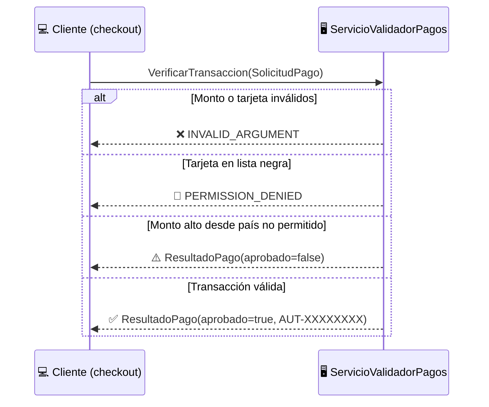
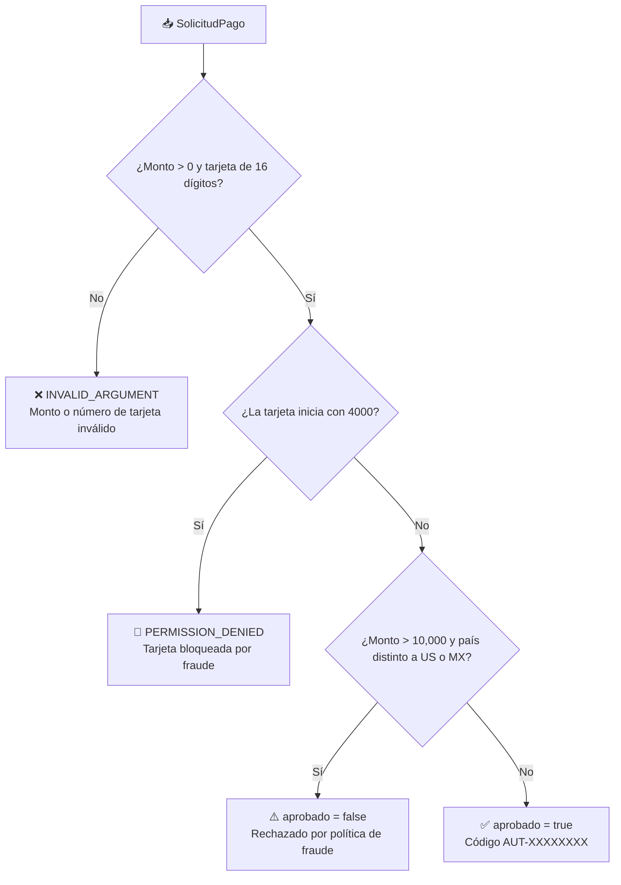

<div align="center">

# 💳 Validador de Pagos Antifraude (gRPC Unario)

### Una pasarela de pagos que decide en milisegundos si una compra con tarjeta se **aprueba** o se **rechaza**


</div>

---

## 📖 Descripción

Una pasarela de pagos procesa **miles de compras por minuto**. Antes de autorizar una transacción con tarjeta de crédito, el checkout necesita verificar **en menos de 50 ms** si es válida, revisando el monto, el país de origen y el estado de la tarjeta.

Este proyecto implementa ese servicio con un **RPC unario**: el cliente envía una `SolicitudPago` y el servidor devuelve un `ResultadoPago` de forma síncrona. Si la solicitud es inválida o la tarjeta está bloqueada, responde con el **código de estado gRPC** que corresponde.

> 💡 **¿Por qué gRPC?** Funciona sobre **HTTP/2** y serializa los mensajes en **binario** con Protobuf, lo que da la baja latencia que exige una autorización de pago.

---

## ✨ Características

| | Característica |
|---|---|
| ⚡ | **RPC unario:** una petición, una respuesta inmediata |
| 🛡️ | **Validación de entrada:** monto positivo y tarjeta de exactamente 16 dígitos |
| 🚫 | **Lista negra:** las tarjetas que inician con `4000` se bloquean por fraude |
| 🌎 | **Política por país:** montos mayores a $10,000 solo se aprueban desde `US` o `MX` |
| 🎫 | **Código de autorización** único (`AUT-XXXXXXXX`) en cada pago aprobado |
| 🚦 | **Errores con códigos gRPC** estándar: `INVALID_ARGUMENT` y `PERMISSION_DENIED` |
| 🧯 | **Cliente robusto:** captura `grpc.RpcError` y muestra `e.code()` y `e.details()` |

---

## 🏗️ Arquitectura



### 🔎 Flujo de validación

El servidor revisa las reglas **en este orden** y se detiene en la primera que se cumple:



---

## 📜 Contrato del servicio

Archivo [`protos/validador_pagos.proto`](protos/validador_pagos.proto):

```proto
service ValidadorPagos {
  rpc VerificarTransaccion (SolicitudPago) returns (ResultadoPago);
}

message SolicitudPago {
  string id_transaccion = 1;
  string numero_tarjeta = 2;
  double monto = 3;
  string codigo_moneda = 4;
  string pais_origen = 5;
}

message ResultadoPago {
  bool aprobado = 1;
  string codigo_autorizacion = 2;
  string motivo_rechazo = 3;
}
```

| Mensaje | Campo | Descripción |
|---|---|---|
| `SolicitudPago` | `id_transaccion` | Identificador de la compra |
| | `numero_tarjeta` | Número de la tarjeta (16 dígitos) |
| | `monto` | Importe de la compra |
| | `codigo_moneda` | Moneda, por ejemplo `USD` |
| | `pais_origen` | País desde donde se hace la compra |
| `ResultadoPago` | `aprobado` | `true` si la transacción se autoriza |
| | `codigo_autorizacion` | Código generado cuando se aprueba |
| | `motivo_rechazo` | Explicación cuando no se aprueba |

---

## 🧯 Reglas de negocio y manejo de errores

| # | Situación | Respuesta del servidor |
|---|---|---|
| 1 | `monto <= 0` o `numero_tarjeta` sin 16 dígitos | `context.set_code(grpc.StatusCode.INVALID_ARGUMENT)` con *"Monto o número de tarjeta inválido"* |
| 2 | La tarjeta inicia con `4000` | `context.set_code(grpc.StatusCode.PERMISSION_DENIED)` con *"Tarjeta bloqueada por fraude"* |
| 3 | `monto > 10,000` y `pais_origen` no es `US` ni `MX` | `ResultadoPago(aprobado=false)` con el motivo de la política de fraude |
| 4 | Ninguna de las anteriores | `ResultadoPago(aprobado=true)` con un código de autorización |

> ℹ️ Las reglas 1 y 2 son **errores gRPC**: el cliente los recibe como `grpc.RpcError`. La regla 3 es una **respuesta normal** con `aprobado = false`.

---

## 🧩 Clases principales

| Clase | Archivo | Responsabilidad |
|---|---|---|
| `ServicioValidadorPagos` | `servidor.py` | Implementa `VerificarTransaccion` y aplica las reglas de negocio |
| `ClienteValidadorPagos` | `cliente.py` | Envía la solicitud con el stub y captura los errores con `except grpc.RpcError as e` |

Métodos internos del servidor:

| Método | Qué hace |
|---|---|
| `_datos_validos(solicitud)` | Comprueba que el monto sea positivo y la tarjeta tenga 16 dígitos |
| `_viola_politica_fraude(solicitud)` | Detecta montos altos desde países no permitidos |
| `_generar_codigo_autorizacion()` | Crea el código `AUT-XXXXXXXX` con `uuid` |

---

## 📁 Estructura del proyecto

```
📦 payment-fraud-validator
 ┣ 📂 protos
 ┃ ┗ 📜 validador_pagos.proto      # Contrato del servicio
 ┣ 📜 validador_pagos_pb2.py       # Generado: clases de los mensajes
 ┣ 📜 validador_pagos_pb2_grpc.py  # Generado: stub y servicer
 ┣ 📜 servidor.py                  # Servidor con las reglas de negocio
 ┣ 📜 cliente.py                   # Cliente con los tres casos de prueba
 ┣ 📜 requirements.txt             # Dependencias
 ┗ 📜 README.md                    # Documentación
```

---

## ⚙️ Requisitos

- **Python 3.10 o superior**
- **grpcio**
- **grpcio-tools**

```bash
pip install -r requirements.txt
```

Para regenerar el código después de modificar el `.proto`:

```bash
python -m grpc_tools.protoc -I protos --python_out=. --grpc_python_out=. protos/validador_pagos.proto
```

---

## 🚀 Ejecución paso a paso

Abre **dos terminales** en la carpeta del proyecto, con el entorno virtual activado.

### 1️⃣ Iniciar el servidor

```bash
python servidor.py
```

```
Servidor ValidadorPagos escuchando en [::]:50051
```

### 2️⃣ Ejecutar el cliente

```bash
python cliente.py
```

El cliente envía los tres casos de prueba y muestra el resultado de cada uno.

---

## 🧪 Casos de prueba

| | Caso | Tarjeta | Monto | País | Resultado esperado |
|---|---|---|---|---|---|
| ✅ | Pago exitoso | `4111111111111111` | `250.00` | `MX` | Aprobado con código de autorización |
| ❌ | Argumento inválido | `4111111111111111` | `-50.00` | `US` | `INVALID_ARGUMENT` |
| 🚫 | Tarjeta denegada | `4000123456789012` | `100.00` | `US` | `PERMISSION_DENIED` |

### 🖥️ Salida del cliente

```
=== Pago exitoso ===
Aprobado: True
Código de autorización: AUT-A178F363
Motivo de rechazo:

=== Argumento inválido (monto negativo) ===
Código de error: StatusCode.INVALID_ARGUMENT
Detalle: Monto o número de tarjeta inválido

=== Tarjeta denegada (lista negra) ===
Código de error: StatusCode.PERMISSION_DENIED
Detalle: Tarjeta bloqueada por fraude
```

> 🎲 El código de autorización cambia en cada ejecución porque se genera con `uuid`.

---

## 🎛️ Configuración

Los valores de las reglas están como constantes al inicio de `servidor.py`:

| Constante | Valor | Para qué sirve |
|---|---|---|
| `DIRECCION` | `[::]:50051` | Dirección y puerto del servidor |
| `LONGITUD_TARJETA` | `16` | Dígitos que debe tener la tarjeta |
| `PREFIJO_LISTA_NEGRA` | `"4000"` | Prefijo de las tarjetas bloqueadas |
| `MONTO_LIMITE_USD` | `10_000` | Monto a partir del cual se revisa el país |
| `PAISES_EMISORES` | `{"US", "MX"}` | Países permitidos para montos altos |

En `cliente.py`, `DIRECCION_SERVIDOR` indica a qué servidor se conecta y el diccionario `casos` contiene las solicitudes de prueba.

---

## 🧠 Conceptos clave

- **RPC unario:** el patrón más simple de gRPC; se parece a llamar a una función local que devuelve un valor.
- **Servicer:** `ServicioValidadorPagos` hereda de `ValidadorPagosServicer`, la clase base generada por `protoc`.
- **Stub:** `ValidadorPagosStub` permite al cliente llamar a `VerificarTransaccion` como si fuera un método local.
- **`context.set_code` y `set_details`:** convierten una validación fallida en un error gRPC con código y mensaje.
- **`grpc.RpcError`:** la excepción que recibe el cliente; `e.code()` da el código y `e.details()` el mensaje.
- **`ThreadPoolExecutor`:** permite al servidor atender varias solicitudes al mismo tiempo.

---

## ⚠️ Consideraciones

- 💵 Se asume que el monto viene en **USD**; no se convierte según `codigo_moneda`.
- 🧪 Las tarjetas son **números de prueba**, no datos reales.
- 🔓 El canal no usa TLS (`insecure_channel`), así que está pensado para ejecución local.

---

## 🩺 Solución de problemas

| Error | Causa probable | Solución |
|---|---|---|
| `StatusCode.UNAVAILABLE` | El servidor no está encendido | Ejecuta `python servidor.py` antes del cliente |
| `ModuleNotFoundError: grpc` | Dependencias no instaladas o entorno sin activar | Activa `.venv` y ejecuta `pip install -r requirements.txt` |
| `ModuleNotFoundError: validador_pagos_pb2` | Falta el código generado | Regenera con el comando de `grpc_tools.protoc` |
| `Failed to bind to address` | El puerto `50051` ya está en uso | Cierra el otro servidor o cambia `DIRECCION` |

---

## 🛠️ Tecnologías

- 🐍 [Python](https://www.python.org/)
- 🔗 [gRPC para Python](https://grpc.io/docs/languages/python/)
- 📦 [Protocol Buffers](https://protobuf.dev/)

---

<div align="center">

⭐ Si este proyecto te fue útil, ¡no olvides dejar una estrella en el repositorio! ⭐

</div>
